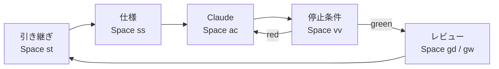

# nvim-config

AI 駆動（仕様駆動）開発のための Neovim + Ghostty + tmux 環境。

人間は仕様・ループ・評価基準の設計者で、コードを書くのは主にエージェント。
だからこのエディタは「書く」より **読む・判断する・エージェントの舵を切る** ことに特化している。
前提となる考え方は [docs/00-dna.md](docs/00-dna.md) にある。

## はじめる

```bash
bash setup.sh
```

`setup.sh` が行うこと（確認つき）:

1. `~/.config/nvim`・`~/.tmux.conf`・`~/.config/ghostty/config` をこのリポジトリにリンク（既存はバックアップ）
2. シェルに `v` と `ws` を登録
3. 依存ツールを brew / npm で導入（ripgrep, fd, fzf, lazygit, gh, tree-sitter, ImageMagick, mermaid-cli, Ghostty など）
4. プラグイン・treesitter パーサーを一括インストール

その後 Ghostty を開き、`ws` でプロジェクトを選ぶ。**慣れるまでは `<Space>L` のレッスンから。**

Ghosttyだけを更新する場合は `bash setup.sh --upgrade-ghostty`（Homebrew管理の既存インストールが対象）。確認だけなら `bash setup.sh --check-ghostty`。通常のセットアップではプラグインを `lazy-lock.json` の版に復元し、更新操作とは分ける。

## 学ぶ

| 入口 | 内容 |
|------|------|
| `<Space>L` / `:Lesson` | 手を動かすレッスン 12 本（Ghostty → 生き残る → 文法 → … → vimmer の習慣）。進捗つき |
| `<Space>H` / `:help nvim-config` | この環境のチートシート |
| `<Space>` を押して待つ | 次に押せるキーの一覧（which-key） |
| `:Tutor` / `:VimBeGood` | 公式チュートリアル / 練習用のミニゲーム |
| [docs/05-learning-path.md](docs/05-learning-path.md) | 学び直しのロードマップ |

## 1 日のループ



| コマンド | キー | 内容 |
|----------|------|------|
| `:Tasks` | `<Space>st` | 引き継ぎ（TASKS.md など）を開く |
| `:Spec` | `<Space>ss` | 規約・引継・計画・文書・スキル・QA の一覧 |
| `:Worktrees` | `<Space>gw` | worktree を新しいタブで開く / 差分レビュー / そこで Claude |
| `:Check` | `<Space>vc` | プロジェクトが明示した日常検証（`make check` / `pnpm check`等） |
| `:Verify` | `<Space>vv` | `make verify` / `pnpm verify` を実行 → quickfix |
| `:VerifyLog` | `<Space>vl` | 実行元・HEAD・時刻・終了コード・全出力を確認 |
| `:ClaudeNew` | `<Space>an` | Claude を追加で起動（並走） |
| `:Preview` | `<Space>mp` | Markdown / Mermaid / HTML をブラウザでプレビュー |

日々の反復は `:Check`、全体の確認は `:Verify`。未定義なら通知し、別の検証へ暗黙に切り替えない。このリポジトリは検証が短いため、`make check` と `make verify` は同じ検査を行う。
作業の依存・担当・差し戻しは [実行グラフの運用](docs/01-dev-loop.md)、検査範囲は [検証の正本](docs/04-verification.md) を参照。役割と保存した監査も `:Spec` から開ける。

## シェルコマンド

| コマンド | 機能 |
|---------|------|
| `v` | `nvim` |
| `ws` | fzf でプロジェクトを選び、新しいウィンドウで tmux + Neovim を開く。**実行した端末アプリ（Ghostty / Terminal.app）で開く**。プロジェクトごとにステータスバーの色が変わる |

`ws` のオプション: `ws <dir>`（選択を省略）、`WS_TERMINAL=ghostty|terminal`（端末を指定）、`WS_SWITCH=1`（tmux 内で今のウィンドウのまま切り替え）、`WS_DRY_RUN=1`（実行せずに表示）。

## 構成

役割分担は **Ghostty = 画面、tmux = 裏方（セッション維持だけ）、Neovim = 分割・Claude を含むすべて**（[ADR-0003](docs/adr/0003-multiplexer-strategy.md)）。

```
.
├── CLAUDE.md / AGENTS.md   エージェント向けの入口
├── docs/                   DNA・要求・構成・検証・ADR・引き継ぎ（Neovim は読まない）
├── lessons/                レッスンの原本（:Lesson が自分用にコピーして開く）
├── init.lua
├── lua/config/             options / keymaps / autocmds / parsers
├── lua/plugins/            プラグイン定義（ドメインごと）
├── lua/workflow/           独自コマンドの実装
├── plugin/                 独自コマンドの登録        ┐
├── after/ftplugin/         ファイルの種類ごとの設定  │ Neovim が
├── after/lsp/              LSP サーバーごとの設定    │ 特別に読む
├── ftdetect/               ファイルの種類の判定      │ ディレクトリ
├── snippets/               仕様・ADR・Mermaid の雛形 │
├── doc/                    :help nvim-config         ┘
├── scripts/                verify.sh（停止条件）/ smoke.lua
├── ghostty/config · tmux.conf · aliases.sh · setup.sh
└── lazy-lock.json
```

詳細は [docs/03-architecture.md](docs/03-architecture.md)、プラグインの選定理由は [ADR-0004](docs/adr/0004-plugin-selection-2026.md)。

## 変更するとき

この設定もループで育てる。

1. 要求を [docs/02-requirements.md](docs/02-requirements.md) に書く
2. 実装する（Claude に任せてよい）
3. `bash scripts/verify.sh`（Neovim 内なら `<Space>vv`）が green になったら完了
4. プラグインの入れ替えなどの判断は [docs/adr/](docs/adr/) に残し、[docs/tasks.md](docs/tasks.md) を更新する

### プラグインの更新

`setup.sh` は `lazy-lock.json` どおりの版を入れるだけで、更新はしない（R-22）。更新は手で行う。

1. Neovim で `:Lazy update`（`lazy-lock.json` が新しい版に書き換わる）
2. `bash scripts/verify.sh` が green なら `lazy-lock.json` をコミットする。壊れたらまず既知の正常なコミットのlockfileへ戻し、`bash setup.sh` のプラグイン導入で固定版を復元する（更新後のlockのままrestoreしても旧版には戻らない）。
