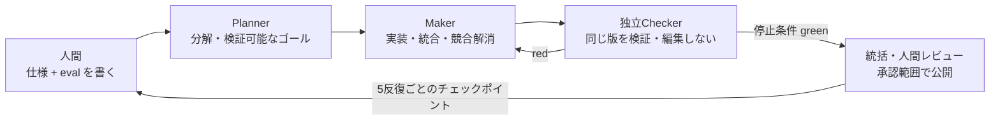

# 00. DNA — この環境が前提とする開発のあり方

> この文書は nvim-config の**存在理由**。プラグインやキーマップは入れ替わるが、ここに書いたことは変わらない。
> 設定を足す・消す判断に迷ったら、まずここに照らす。

## 大前提

**開発は AI 駆動（仕様駆動）で行う。コードを書くのは主にエージェント、人間は仕様・ループ・評価基準の設計者。**

- エージェントが Planner → Maker → 独立Checker に役割を分ける。独立した仕事だけを並走させ、統括が最終版の証拠を確認する。
- 人間はハーネスを組み、ループエンジニアリングを回す。一行ずつ書く「作業者」ではない。
- したがってエディタの主用途は **書く** より **読む・判断する・舵を切る** にある。

## 原則（他プロジェクトと共通の DNA）

1. **人間が書くのは仕様（spec）と評価基準（eval）。** 実装の細部ではない。
2. **停止条件は機械が真偽判定できること。** 「いい感じ」は停止条件にならない。
3. **Maker ≠ Checker。** 自分で書いたものを自分で「完了」と承認しない（自己承認バイアスの排除）。
4. **記憶はコンテキストではなくディスクに置く。** エージェントは忘れるが、リポジトリは忘れない。
   → `CLAUDE.md` / `AGENTS.md` / `docs/` / `docs/tasks.md` が外部メモリ。
5. **矛盾は止めて報告する。** 母艦設計書と食い違う実装を黙って進めない。
6. **5 反復ごとに人間チェックポイント。** 理解負債（生成物を人間が説明できない状態）を溜めない。
7. **完了の証拠と戻し方をセットで持つ。** 「画面が出た」は完了ではない。証拠は確認した版に結び付け、未コミット変更をHEADだけで保証しない。

## このエディタ環境に落とすと

| DNA | エディタに求めること |
|-----|----------------------|
| 人間は仕様を書き、読む | Markdown・Mermaid・HTML 設計書を**リッチに**読める。仕様へ一瞬で飛べる |
| Maker ≠ Checker | エージェントの diff を**レビューしやすい**（hunk 単位、worktree 横断） |
| 停止条件は機械判定 | `make verify` / `pnpm verify` の結果が quickfix に落ち、赤から直接飛べる |
| 記憶はディスクに | `TASKS.md`・`plans/`・`docs/` をエディタの「ホーム」として扱う |
| 並走するエージェント | 複数の worktree・複数の Claude セッションを**見失わない** |
| 人間チェックポイント | 変化を検知・可視化（自動リロード、git 差分、通知） |

## この環境自体にも DNA を適用する

nvim-config もエージェントと一緒に育てる。つまりこのリポジトリも同じループで回す。

- 変更は [02-requirements.md](02-requirements.md) の要求 ID に紐づける。
- 採用・不採用の判断は [adr/](adr/) に残す（「なぜそのプラグインか」を忘れないため）。
- 役割・書き込み所有・差し戻し・同じ版の確認は [01-dev-loop.md](01-dev-loop.md) に集約する。
- 完了は [04-verification.md](04-verification.md) の停止条件で判定する。
- セッションをまたぐ進捗は [tasks.md](tasks.md) に書く。
