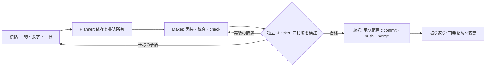

# 01. 開発ループ — 役割・同じ版・ハーネス

**現在の開発運用の正本。** 原則は [DNA](00-dna.md)、要求は [02](02-requirements.md)、検査の内容と合否は [04](04-verification.md)、日々の操作は [06](06-operations.md)。採用理由は [ADR-0006](adr/0006-execution-graph.md) と [ADR-0007](adr/0007-agent-signals-and-tree-id.md)。

## 実行グラフ

人が目的と受け入れ条件を決め、作る担当と確認する担当を分ける。基本は直列で、独立した仕事だけを並列にする。



| 役割 | 責任 | 書き込みと受け渡し |
|---|---|---|
| 統括 | ユーザーの目的・優先・上限を確認し、担当を割り振る。最終版の証拠をそろえて公開する | 共有ファイルの所有者を決める。push・merge 等はユーザーの承認範囲内で行う |
| Planner | 要求 ID、依存、変更範囲、完了条件を作業パケットにする | 実装前に担当間の境界と順番を明確にする |
| Maker | 所有範囲を実装し、必要なテストと文書を更新する。**統合・競合解消も担当する** | 他人の未コミット変更を消さない。変更と検証結果を Checker へ渡す。自己承認しない。push しない |
| Checker | 原本・差分・検証結果を別の文脈で照合する | 成果物を編集せず、対象版つきの判定を返す。問題は Maker へ差し戻す。commit・push・merge しない |

統括が統合のためにコードを書いた場合も、その部分では Maker である。統合後の版を別の Checker が確認する。
仕様の矛盾は止めて報告し、確認待ちでも独立して進められる作業は続ける。5 反復ごとの人間チェックポイントを維持する。

### 並列にする条件

互いの途中結果を必要とせず、書き込むファイルも重ならない仕事だけを並列にする。プラグイン定義、`lazy-lock.json`、コマンド登録、共通テスト、`docs/tasks.md` は共有されやすいので、担当を一人にする。

並走させるときは worktree で隔離する（`<Space>aW`）。別 worktree で作業していても、統合後の整合性確認は省略しない。担当数・時間・再試行の上限は作業パケットに書く。小さな修正は Maker 一人と Checker で足りる。

### 作業パケット

統括から担当へ渡す依頼に、次の項目を短く書く。会話全体だけを渡して、所有範囲や完了条件を推測させない。

```text
目的 / 要求ID:
対象repo・worktree:
原本・参考資料:
触ってよいファイル / 触らないファイル:
依存・先に必要な成果:
成果物の場所:
完了条件・検証コマンド:
時間・反復・並列数の上限:
問題があったときの戻し先:
```

Checker にも要求と原本を渡す。Maker の説明は確認の手掛かりであり、判定の根拠そのものにはしない。

## 同じ版を確認する

**HEAD の SHA は未コミットの変更を区別できない。** 版は作業木の内容の ID（tree ID）で特定する。

`make tree-id`（[`scripts/tree-id.sh`](../scripts/tree-id.sh)）は、追跡中の変更と、ignore されていない未追跡ファイルを含めた内容を一つの ID にする。同じ内容なら誰が計算しても同じ値になり、その内容を commit しても変わらない。実際の index・作業木・HEAD は変更しない。

1. Maker は書き込みを止め、`make check` を実行する。出力末尾の `tree:` 行が「検証した内容」を示す。
2. Checker は `make tree-id` が Maker の報告と一致することを確かめてから検証し、検証後も同じ値であることを確かめる。
3. その後に競合解消・追加修正・取り込みで ID が変わったら、判定を流用せず再検証する。

Checker は少なくとも次を報告する。

```text
対象: repo / worktree / branch / HEAD SHA / tree ID
検証: コマンド / 終了コード / 検証前後の tree ID
判定: 合格、差し戻し、判断待ち
根拠・未確認範囲・次の担当:
```

tree ID が含まないもの: ignore されたファイル、`.claude/worktrees/` 以下（並走エージェントの worktree。それぞれが自分の ID を持つ）、リポジトリの外にある状態（導入済みプラグインの実体、外部ツールの版、端末アプリ）。これらに依存する確認は、環境とともに別に記録する。PR を使う場合は head SHA も判定に含める。PR へのコメント投稿は、依頼で許可されている場合だけ行う。

## Check と Verify

- 日常の反復は `:Check`、節目の全体検証は `:Verify`。プロジェクトが明示した定義だけを使い、一方が未定義でも他方で代用しない。
- nvim-config 自身は検査が短いため、`make check` と `make verify` が同じ全体検証を呼ぶ。停止条件を弱めない。
- どちらも開始時と終了時の tree ID を記録する。実行中に内容が変わった結果は green と表示しない。

検査の内容と合否は [04](04-verification.md)、キーとログの見方は [06](06-operations.md)。

## ハーネスで支える範囲

| 仕組み | 実体 | すること | 限界 |
|---|---|---|---|
| 役割定義 | [maker](../.claude/agents/maker.md) / [checker](../.claude/agents/checker.md) | 役割ごとの責任とツールを定める | 通常の Claude 起動が自動で役割に変わるわけではない |
| 役割ガード | `scripts/role-guard.*`（PreToolUse） | Maker の push、Checker の書き込み・公開など典型的な越境を拒否する | 任意の shell 処理を隔離する sandbox ではない |
| 版の照合 | `scripts/tree-id.sh` | 未コミットを含む内容を一つの ID にする | ignore されたファイル、`.claude/worktrees/`（並走エージェントの別の作業木）、リポジトリ外は含まない |
| 検証済みの記録 | `scripts/verify.sh` → `.git/nvim-verify-stamp` | green で、検証中に内容が変わらなかったときだけ tree ID を記録する | 書き換えられる。証拠の本体は検証の出力 |
| 開始時の文脈と Stop ゲート | [settings](../.claude/settings.json) → `scripts/agent-gate.sh` | 開始時に「検証済みの内容か」を伝える。green を確認した内容と違う作業木を残して終えようとしたら、同じ内容については一度だけ検証を促す | 促すのは一度。赤のまま、または理由を添えて未検証で終えることは妨げない |
| 状態の通知 | `scripts/claude-hooks.json` → `scripts/agent-signal.sh` | Neovim から起動した Claude の状態（作業中・判断待ち・完了）をエディタへ送る | Neovim の中で起動したセッションだけ。通知が失敗しても Claude は止めない |
| 読み取り監査 | [audit workflow](../.claude/workflows/audit.js) | 対象ごとの調査と、独立した二者による反証を分けて回す | commit 済みの版が対象。読み取り限定はプロンプト上の方針 |

**これらは誤操作と忘れを防ぐ補助であり、権限の境界ではない。** 迂回しない。実際の操作権限は実行セッションの設定で管理する。

**Codex には `.claude/` の定義も hook も自動適用されない。** 統括が依頼に所有範囲と禁止操作を明記し、`make check` と `make tree-id` を同じように使う。ファイルを置いただけで、すべてのエージェントを制限できたとは扱わない。

audit workflow は `/workflows` から選び、`lens`（観点）、`targets`（対象一覧）、`revision`（完全な commit SHA）、`context`、`concurrency`（2 または 3）を渡す。結果の `complete` は未確認・失敗が無いことを表し、検証コマンドの合格や公開許可を意味しない。dirty な内容を対象にするときは、先に commit する。定義と mock テストの合格だけで、実 LLM での実行を確認したとは扱わない。

## 記録と改善

現在の進捗・未確認事項・次の一手は [tasks](tasks.md)、設計判断は ADR、変更の経緯は Git 履歴に残す。書く場所は [docs の索引](README.md) の表で決める。

節目では繰り返した手戻りを一件選び、テスト・hook・スクリプト・作業パケットの改善に変える。「次から注意する」だけで終えず、別のケースでも効くか確認する。検査を外したり期待値を実装に合わせたりして green を増やさない。
