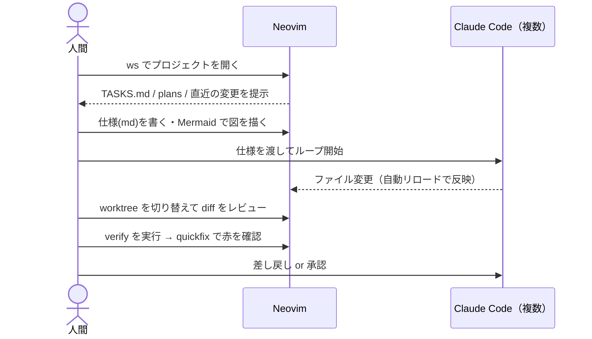

# 01. 開発ループと、その中でのエディタの役割

[00-dna.md](00-dna.md) の原則が、日々の作業としてどう回っているかの記述。
設定を設計するときの「ユーザーの 1 日」として使う。

## 実際の運用（bukatsu-one 系から抽出, 2026-09 時点）

### 仕様・計画・タスク（すべて Markdown が正）

| 種類 | 置き場所の例 | エディタでの扱い |
|------|--------------|------------------|
| 母艦設計書 | `docs/design/*-spec.md` | 最も頻繁に読む。目次ジャンプが要る |
| 機能仕様 | `docs/features/*.md`（`_template.md` あり） | Mermaid の状態遷移図を含む |
| 判断記録 | `docs/adr/NNNN-*.md` | 番号付きで検索 |
| 計画 | `plans/*.md`（作業・依存・担当・完了の証拠/戻し方の表） | **表の可読性**が重要 |
| 引き継ぎ | `TASKS.md` / `docs/development/tasks.md` | セッション開始時に必ず開く |
| エージェント規約 | `CLAUDE.md` / `AGENTS.md` / `CONVENTIONS.md` / `.claude/skills/` | 頻繁に編集 |
| QA 検査項目 | `qa/cases/*.yaml` | YAML の構造把握 |

### 図・設計書（読む専用が多い）

- Mermaid 入りの Markdown（1 リポジトリで 15〜20 ブロック程度）
- ER 図: `docs/database/*.md` + `erd.html`
- 構成図: `docs/assets/infrastructure.html`（headless Chrome で PNG/PDF に書き出している）
- 公開デモ: 単一の `index.html`（数 MB）
- マニュアル PDF

→ **Mermaid と HTML をエディタから即座に見られること**が要件になる（[R-02, R-03](02-requirements.md)）。

### エージェントの起動と並走

- Claude Code を Agent Teams（in-process）で使う。`/loop-start` `/orchestrate` `/verify` などのコマンドを使う。
- Maker は隔離 worktree で動く:
  - 自動: `<repo>/.claude/worktrees/agent-<hex>`（1 リポジトリに 10 個以上溜まることがある）
  - 手動: `~/devel/<repo>-<topic>` の兄弟ディレクトリ（例: `bukatsu-one-api-ri`）
- 既知の困りごと: `.claude/worktrees` の中身を ESLint や grep が拾ってしまう。

→ ファイル検索・grep は `.claude/worktrees` を**既定で除外**し、worktree の切り替えは**専用の操作**で行う（[R-05](02-requirements.md)）。

### 検証（停止条件）

- TypeScript 系: `pnpm verify`（lint → typecheck → knip → test → build）+ Playwright/axe
- Go 系: `make verify`（build / test -race / vet / golangci-lint / govulncheck）

→ verify の実行と結果の quickfix 化をエディタからワンキーで（[R-06](02-requirements.md)）。

## 人間の 1 日（エディタ視点）

## tmux との関係（現状）

- `ws` コマンドで、プロジェクトごとに色分けした tmux セッションを作り、nvim を起動している。
- Claude Code は nvim 内のターミナル（claudecode.nvim）でも、tmux ペインでも動かしている。
- **課題**: nvim の分割と tmux のペインという 2 つのレイヤーを行き来する操作が煩雑。
  → どちらに寄せるかは [adr/0003](adr/0003-multiplexer-strategy.md) で判断する。
