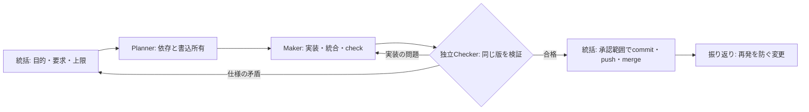

# 01. 開発ループ — 仕様・実行グラフ・独立検証

この文書は **現在の開発運用の正本**。原則は [DNA](00-dna.md)、要求は [02-requirements.md](02-requirements.md)、検証の内容と合否は [04-verification.md](04-verification.md) を参照する。採用理由は [ADR-0006](adr/0006-execution-graph.md)。研究資料とHTMLは教材であり、現在の手順を上書きしない。

## 基本の実行グラフ

人が目的と受け入れ条件を決め、作る担当と確認する担当を分ける。基本は次の直列の流れで、独立した仕事だけを並列にする。



| 役割 | 責任 | 書き込みと受け渡し |
|---|---|---|
| 統括 | ユーザーの目的・優先・上限を確認し、担当を割り振る。最終版の証拠をそろえて公開する | 共有ファイルの所有者を決める。push・merge等はユーザーの承認範囲内で行う |
| Planner | 要求ID、依存、変更範囲、完了条件を作業パケットにする | 実装前に担当間の境界と順番を明確にする |
| Maker | 所有範囲を実装し、必要なテストと文書を更新する。**統合・競合解消も担当する** | 他人の未コミット変更を消さない。変更と検証結果をCheckerへ渡す。自己承認しない |
| Checker | 原本・差分・検証結果を別の文脈で照合する | 成果物を編集せず、対象版つきの判定を返す。問題はMakerへ差し戻す。commit・push・mergeしない |

統括が統合のためにコードを書いた場合も、その部分ではMakerである。統合後の版を別のCheckerが確認する。

### 並列にする条件

互いの途中結果を必要とせず、書き込むファイルも重ならない仕事だけを並列にする。プラグイン定義、`lazy-lock.json`、コマンド登録、共通テスト、`docs/tasks.md` は共有されやすいので、担当を一人にする。別worktreeで作業していても、統合後の整合性確認は省略しない。

担当数・時間・再試行の上限は作業パケットに記載する。小さな修正はMaker一人とCheckerで足りる。仕様の矛盾は [DNA](00-dna.md) に従い報告し、確認待ちでも独立して進められる作業は続ける。5反復ごとの人間チェックポイントも維持する。

### 作業パケット

統括から担当へ渡す依頼には、次の項目を短く書く。会話全体だけを渡して、所有範囲や完了条件を推測させない。

```text
目的 / 要求ID:
対象repo・worktree:
原本・参考資料:
触ってよいファイル / 触らないファイル:
依存・先に必要な成果:
成果物の場所:
完了条件・検証コマンド:
時間・反復・並列数の上限:
問題があったときの戻し先:
```

Checkerにも要求と原本を渡す。Makerの説明は確認の手掛かりであり、判定の根拠そのものにはしない。

## 同じ版を確認する

Makerが統合と保存を終え、検証対象への書き込みを止めてからCheckerへ渡す。Checkerは少なくとも次を報告する。

```text
対象: repo / worktree / branch / HEAD SHA
未コミット変更: なし、または対象ファイル・差分を特定できる記録
検証: コマンド / 終了コード / 結果の場所
判定: 合格、差し戻し、判断待ち
根拠・未確認範囲・次の担当:
```

**SHAだけでは未コミット変更を特定できない。** ローカルレビューでは、HEADと `git status --short` に加え、変更差分と未追跡ファイルの内容を特定できる記録を保持する。`git diff` だけでは未追跡ファイルは記録できない。完全な記録を作れないときは、書き込みを止めた対象を直接照合し、変更が入ったら再検証する。

Checkerの後に競合解消・追加修正・取り込みで対象が変われば、判定をそのまま流用しない。統括は最終版と証拠が一致することを確認してから、承認された公開操作を行う。PRを使う場合はhead SHAを判定に含める。PRへのコメント投稿は、依頼で許可されている場合だけ行う。

## CheckとVerify

- 日常の反復は `:Check`（`<Space>vc`）。対象プロジェクトが定義した `check` を実行する。
- 節目の全体検証は `:Verify`（`<Space>vv`）。`check` が未定義でも、暗黙に `verify` で代用しない。
- nvim-config自身の `make check` と `make verify` は、短い既存の全体検証を共用する。停止条件を弱めない。
- 合否、実行方法、追加検査、目視確認の範囲は [検証の正本](04-verification.md) に集約する。

コマンドは保存成功後に開始する。別worktreeへ移動しても診断は実行元を指す。ログには対象と実行結果を残すが、それだけで変更後の内容まで検証済みになるわけではない。

## ハーネスで支える範囲

Claude Code向けの役割定義は [Maker](../.claude/agents/maker.md) と [Checker](../.claude/agents/checker.md) に置く。hookは役割を越える典型的な操作を防ぐ補助であり、任意のshell処理を完全に隔離するsandboxではない。設定の適用範囲と残る制約を理解して使う。

Makerの `git push` は作業ブランチ宛ても含めてガードで拒否する。実装・統合を終えたら主担当へ返し、検証後のpushを統括が担当する。

**Codexでは `.claude/agents/` のツール制限やClaude Codeのhookは自動適用されない。** 統括が依頼に所有範囲と禁止操作を明記し、利用可能な権限設定と独立レビューで境界を保つ。ファイルを置いただけで、すべてのエージェントを制限できたとは扱わない。

横に広い読み取り監査は、保存した [audit workflow](../.claude/workflows/audit.js) を利用できる。Claude Codeの対応環境で `/workflows` から選び、`lens`（観点）、`targets`（対象一覧）、`revision`（完全なcommit SHA）、`context`、`concurrency`（2または3）を渡す。対象ごとの調査と指摘の反証を分け、結果の版一致を確認し、未確認・失敗を合格と分けて返す。

このworkflowの読み取り限定はプロンプト上の方針であり、Maker／Checkerの役割hookを継承するものではない。実際の操作権限は実行セッションの設定で管理する。監査結果の `complete` は未確認・失敗がないことを表し、検証コマンドの合格や公開許可を意味しない。

この保存workflowはcommitされた版を対象とする。dirtyな内容を対象にするときは、対象の変更を確認してcommitしてから実行する。ローカルでの未コミット差分レビューとは区別する。実行には対応Runtimeが必要で、定義・mockテストの合格だけで実LLMの実行を確認したとは扱わない。途中で人の承認が必要な仕事は承認の前後で分け、最終的な採否は統括が判断する。

## エディタでの作業

| 目的 | 入口 | 正本・成果物 |
|---|---|---|
| 続きから始める | `<Space>st` | プロジェクトのタスク記録。nvim-configは [tasks](tasks.md) |
| 仕様・教材を読む | `<Space>ss` / `<Space>sg` | Markdown・HTML・Mermaid・スキルの原本 |
| 図を見る | `<Space>mp` | 現在のファイルのプレビュー。インライン表示の実画面確認は別に行う |
| worktreeを移る | `<Space>gw` | タブごとの作業ディレクトリ |
| エージェントを扱う | `<Space>ac` / `<Space>an` / `<Space>al` | メイン・追加のClaudeセッション |
| 差分と証拠を確認する | `<Space>gd` / `<Space>vc` / `<Space>vv` / `<Space>vl` | 差分・診断・実行ログ |

Ghosttyが表示、tmuxがプロジェクトのセッション保持、Neovimが分割・移動・Claude操作を担当する。[ADR-0003](adr/0003-multiplexer-strategy.md)の役割分担を維持する。`ws` は同名ディレクトリを正規化パスで区別し、既存の対応するセッションへ戻る。

## 記録と改善

現在の進捗・未確認事項・次の一手は [tasks](tasks.md)、設計判断はADR、変更の経緯はGit履歴に残す。教材や過去のレビューへ最新仕様を重複して追記しない。

節目では繰り返した手戻りを一件選び、テスト・hook・スクリプト・作業パケットの改善に変える。「次から注意する」だけで終えず、別のケースでも効くか確認する。検査を外したり期待値を実装に合わせたりしてgreenを増やさない。
