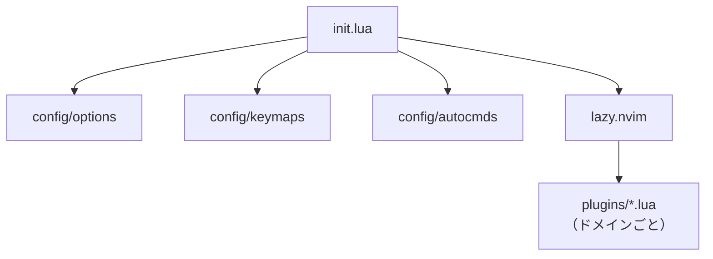

# 03. 設定の構成

> プラグインの選定理由は [ADR-0004](adr/0004-plugin-selection-2026.md)。

## 方針

- **ドメイン（やりたいこと）ごとにファイルを分ける。** 種類（UI、LSP…）より「何のためか」で分ける。
- 1 ファイル 200〜400 行を目安にする。上限は 800 行。
- 各ファイルの先頭コメントに、対応する要求 ID（`R-xx`）を書く。
- プラグインを追加したら、キーマップを which-key のグループに登録する（[R-12](02-requirements.md)）。

## 読み込みの流れ



## ディレクトリ（現状）

```
.
├── CLAUDE.md / AGENTS.md   # エージェント向けの入口
├── docs/                   # DNA・運用・要求・ADR（設定として自動実行しない）
├── .claude/agents/          # Claude CodeのMaker/Checker定義
├── .claude/workflows/       # 保存した読み取り監査
├── .claude/settings.json    # Claude Codeのhook設定
├── init.lua
├── lua/config/             # options / keymaps / autocmds / parsers / indent
├── lua/plugins/            # lazy.nvim のプラグイン定義（ドメインごと。下表）
├── lua/workflow/           # 独自コマンドの実装（verify / worktree / spec / claude / preview / lesson / tabline）
├── scripts/                # verify・回帰検査・役割guard・文書リンク検査
├── Makefile                # check / verify / doc-links-check の入口
├── ghostty/config          # Ghostty の設定（setup.sh がリンク）
│
│   ── 以下は Neovim が特別に読む runtimepath ディレクトリ ──
├── plugin/                 # 独自コマンドの登録（起動時に自動で読む）
├── after/ftplugin/         # ファイルの種類ごとの設定（標準の ftplugin の後に効く）
├── after/lsp/              # LSP サーバーごとの設定（nvim-lspconfig の既定の後にマージ）
├── ftdetect/               # ファイルの種類の判定を追加（.mmd → mermaid など）
├── snippets/               # 自作スニペット（VS Code 形式。仕様・ADR・Mermaid の雛形）
├── doc/                    # :help nvim-config。起動時に helptags を自動生成
├── setup.sh / aliases.sh / tmux.conf
└── lazy-lock.json
```

### lua/plugins/ の分け方

| ファイル | ドメイン | 要求 |
|----------|----------|------|
| `ui.lua` | テーマ・ステータスライン（worktree 名）・アイコン | — |
| `snacks.lua` | ピッカー・エクスプローラー・ダッシュボード・画像・通知・切り替え | R-01, R-02, R-05 |
| `whichkey.lua` | Leader グループの地図 | R-11 |
| `navigation.lua` | oil・flash・harpoon・セッション・servery | R-10, R-12 |
| `coding.lua` | 補完・テキストオブジェクト・編集の増幅 | R-12 |
| `lsp.lua` / `treesitter.lua` / `formatting.lua` / `linting.lua` | 言語サポート | — |
| `git.lua` | hunk・差分レビュー・worktree | R-05, R-07 |
| `ai.lua` | Claude Code | R-09 |
| `markdown.lua` | 整形表示・ブラウザプレビュー | R-01〜R-03 |
| `spec.lua` / `quickfix.lua` | 外部メモリ・停止条件・一括置換 | R-04, R-06 |
| `learning.lua` | hardtime・precognition・チートシート | R-11 |

### 独自コマンド（lua/workflow/）

| コマンド | 実装 | 要求 |
|----------|------|------|
| `:Check` `:Verify` `:VerifyLog` | `verify.lua` | R-06 |
| `:Spec` `:Tasks` `:Plans` `:Adr` `:SpecGrep` | `spec.lua` | R-04 |
| `:Worktrees` | `worktree.lua` | R-05, R-07 |
| `:ClaudeNew` `:ClaudeSessions` | `claude.lua` | R-09 |
| `:Preview` `:PreviewStop` | `preview.lua` | R-02, R-03 |
| `:Lesson` | `lesson.lua` | R-11 |
| （タブライン） | `tabline.lua` | R-05 |

プロジェクト操作は現在のタブのcwdからrootを解決する（`project.lua`）。worktreeごとにタブを分けると、検証や仕様検索の対象も切り替わる。`Preview`は現在のバッファ、`VerifyLog`は直前に実行したCheck/Verifyの記録を対象にし、表示時のcwdへ付け替えない。Lessonは設定リポジトリの教材を扱う。

### 実行グラフと検証の接続

運用ルールの正本は [01-dev-loop.md](01-dev-loop.md)、検査の内容は [04-verification.md](04-verification.md)。Claude Codeの役割定義・hook・監査workflowは `.claude/`、guardの実装と回帰検査は `scripts/` に分ける。CodexではClaude Code用の権限制限やhookは自動適用されない。

`verify.lua`はCheck/Verifyの明示定義を選び、root・mode・コマンド・開始終了時刻/HEAD・終了コードを保持する。両モードは同時には実行せず、ログは共用のscratch bufferに表示する。永続的な監査ログではないため、引き継ぎに必要な証拠は成果物とともに別途記録する。

### 特殊ディレクトリの使い分け

| やりたいこと | 置き場所 | 理由 |
|--------------|----------|------|
| 独自コマンドの登録 | `plugin/*.lua` | 起動時に自動で読まれる。実装は `lua/workflow/` に分けて、呼ばれたときに読む |
| md は折り返す、Go はタブ | `after/ftplugin/<ft>.lua` | autocmd より見通しがよい。`after/` なので標準設定を確実に上書きする |
| LSP サーバーの設定 | `after/lsp/<server>.lua` | 1 サーバー 1 ファイル。`lsp/` だと nvim-lspconfig に上書きされうる |
| 拡張子と filetype の対応 | `ftdetect/*.lua` | `vim.filetype.add` を起動時に確実に読む |
| 雛形 | `snippets/*.json` | エディタに依存しない VS Code 形式で持つ |
| 学習用チートシート | `doc/*.txt` | `:help` から引ける＝手を止めずに調べられる |

> `docs/` は Neovim の runtimepath 上の特殊ディレクトリ（`plugin/`, `ftplugin/`, `after/`, `doc/` など）ではないので、
> 設定としては自動実行されない。Spec Hubは文書を一覧し、検証は参照切れを確認する。一方、単数形の `doc/` は `:help` の対象。**設計書は `docs/`、エディタ内で引くヘルプは `doc/`** と使い分ける。
