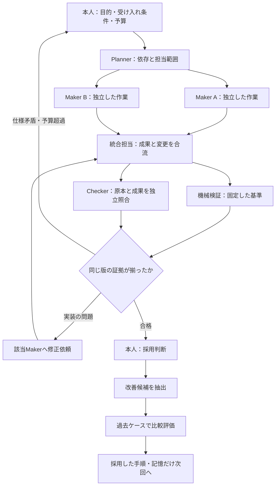

# ハーネス・ループ・グラフ設計：個人のエージェントチームを強くする調査と提案

> **調査時点の記録（2026-10-27）**。本文の「現在」「未実装」「提案」は調査時点を指す。現在の運用は [開発ループ](01-dev-loop.md)、合否は [検証](04-verification.md)、実装状況は [tasks](tasks.md) を参照する。

調査日：2026-10-27（日本時間）。対象：本人＋エージェントチームの生産性を最優先し、成果が出た運用をチーム開発へ展開する。以下の「提案」「仮の目標」は、この環境向けの設計判断であり、製品の保証や実測効果ではない。

**提案の結論**

今の環境で優先すべきなのは、既存の Planner → Maker → Checker に、①仕事の依存関係、②検証対象の版と証拠、③次回へ引き継ぐ改善を明示すること。再利用可能な手順を一つ完成させ、独立した仕事だけを少人数で並列化する。

すでに要求 ID、ADR、検証スクリプト、外部メモリ、エージェント用コマンドがある。これらを結び直す投資から始める。最初の成功条件は「同じ品質で、人間が少ない時間でより多くの成果を受け入れられること」とする。

## 1. 何が新しく、何が従来からあるのか

「グラフエンジニアリング」という呼称が最近話題になった、という認識には根拠がある。LangChain は2026年7月22日の公式記事で直前の週末のX投稿を取り上げ、8月21日にはタスク・エージェント・実行状態をグラフで整理するサーベイが公開された。ただし呼称の流行と、方式の優位性・業界での採用率は別問題である。[LangChain](https://www.langchain.com/blog/3-years-of-graph-engineering-with-langgraph)、[サーベイ](https://arxiv.org/abs/2608.21156)

既存のワークフロー、状態機械、依存関係管理をエージェントへ適用する部分が大きい。最近の実用上の変化は、一つのノードに単発のモデル呼び出しだけでなく、内部で試行錯誤するエージェントを置けること。ループは循環を持つグラフの一種であり、置き換えられるものではない。[LangChain](https://www.langchain.com/blog/3-years-of-graph-engineering-with-langgraph)

説明のために、責任を次のように分ける。用語の境界は実装によって重なる。

| 設計対象 | 答える問い | 個人環境の例 |
|---|---|---|
| プロンプト | 何をしてほしいか | 変更目的・制約・成果物を伝える |
| コンテキスト | 今、何を見せるか | 関連する要求、ADR、コード、未解決事項を渡す |
| ハーネス | どう実行し、記録し、制御するか | ツール、作業領域、権限、ログ、検証、再開 |
| ループ | 結果をどう評価し、次の試行へ戻すか | 実装→テスト→失敗分析→修正 |
| 実行グラフ | 誰が何を担当し、どの条件で次へ進むか | 並列調査→統合→独立検証→採用／差し戻し |

これは成熟度の階段ではない。小さな修正には単純なループで足り、複雑な仕事にだけ分岐や合流を足す。Anthropicも、最小の構成から始め、必要な場合に複雑さを増やす方針を示している。[Building effective agents](https://www.anthropic.com/research/building-effective-agents)

## 2. 共有された投稿・記事の解析

### A. 最初のGoogle講座紹介の投稿

対象：[0xCodilaの2026-10-25投稿（日本時間）](https://x.com/0xCodila/status/2114014120064217157)。ブラウザで本文と返信を確認した。投稿はハーネス、評価、ループ、自己改善の講座を紹介し、返信で `@anniewangtech` に謝辞を述べ、後述のGraph Engineering記事へ誘導している。

投稿の説明と動画の全発言は同一視しない。今回、動画全編の音声・コード実演は検証していない。関連する公開教材として、Googleの短縮URLから参照できる [AI Harness Crash Course](https://g.dev/ai/ai-harness) を確認した。教材は、文脈・記憶、ツールと実行順序、実行環境、評価を分けて説明する。ただし、これが投稿内の長尺動画と同一内容であることまでは確認していない。

実用上は「講座を全部追う」より、自分の一つの作業をこの四つの責任に分け、欠けた部分を補う読み方がよい。

### B. 「1,000+ agent loops」のGraph Engineering記事

対象：[原記事](https://x.com/0xCodila/status/2079597821511020996)。本文はユーザー提供テキストを読んで分析し、製品仕様は公式資料で照合した。

**良い点**は、不要な直列実行を外すこと、独立した検証、書き込み領域の分離、実測のテストを要求すること、単純な仕事には使わないこと。見出しの規模より、この実行条件に価値がある。

| 記事の主張 | 判定と補足 |
|---|---|
| Dynamic workflowsでJavaScriptが複数エージェントを調整する | 公式で確認できる |
| 1回で1,000エージェント | 累計上限。1,000体の同時実行という意味ではない |
| 同時実行は最大16 | 現行仕様では既定値。設定可能であり普遍的な固定上限ではない |
| `/workflows` から保存・再利用 | 可能。個人用とプロジェクト用の保存先がある |
| 調整がコードなので無料 | エージェント実行には使用量が発生する。全体の費用がゼロになるわけではない |

現行の仕様・制限は [Claude Code公式](https://code.claude.com/docs/en/workflows) を基準にする。ローカルの `claude --version` は **2.1.311**。バージョン上は対応するが、アカウント契約、組織ポリシー、実際のワークフロー実行は未確認。

記事の説明は次の点を補正して読む必要がある。以下は設計上の分析である。

- **データを受け渡さない二つの作業でも、独立とは限らない。** 同じファイル、DB、ポート、作業ツリー、API制限を共有すれば競合する。データ依存に加え、資源・書き込み・順序の制約を見る。
- **グラフ化だけではGoodhartの問題は解決しない。** 全担当が同じ誤った指標を最適化すれば、同じ方向に間違える。外部の成功基準と、基準を変更する権限の分離が要る。
- **別コンテキストは独立検証の一条件。** 同じ誤った原本や弱いテストを使えば、全員が誤る。Checkerには原本と反証方法を渡す。
- **worktreeは編集競合を減らすが、意味的な衝突は残る。** 別ファイルでもAPI契約を同時に変えると破綻する。統合責任者と統合後の検証が要る。
- **直列の仕事もグラフで表せる。** 記事の「独立な二つがなければグラフではない」は厳密には違う。並列化の利益がない、という意味で読む。
- **ファイル単位の監査には見落としがある。** たとえば認証はルート、ミドルウェア、設定の関係で決まる。担当境界には共有依存も含める。

大規模なBun移植は実在する。Bun公式は、約50 workflows、11日、ピーク64 agentsを報告する。記事の約100万行は差分の追加行数、約16.5万ドルはマージ前トークンのAPI価格換算であり、一般的な個人作業の費用対効果を示す数字ではない。継続的な人間監督と検証、回帰修正も含む事例である。[Bun公式](https://bun.com/blog/bun-in-rust)

### C. 「Anthropic・60%高速化・dreaming」の投稿

対象：[hayatomaruuの投稿](https://x.com/hayatomaruu/status/2113719510985269442)。ユーザーが貼付した本文の各主張を検証した。

| 主張 | 判定 |
|---|---|
| ハーネス、実行環境、セッションログを分離する | Anthropic公式で確認 |
| 脳と手を分けて60%高速化 | 自社基盤で **p50の最初のトークンまでの時間（TTFT）が約60%短縮**。仕事全体の60%短縮ではない |
| 障害後、永続ログから再開 | Managed Agentsの設計として確認 |
| dreamingが過去のログから記憶を整理する | 公式機能として確認 |
| $350K–$950Kで雇われた、99%が手作業、同モデルで10倍信頼性 | 当人の発言・調査・比較実験などの一次根拠を今回確認できず |
| 毎晩、必ず賢くなる／自動的に新スキルになる | 性能向上の保証としては扱えない |

TTFTの数字は [Scaling Managed Agents](https://www.anthropic.com/research/managed-agents) にある。クラウド基盤の設計変更の測定結果なので、ローカルの設定ファイルを分けるだけで再現できる効果ではない。

[Dreams公式仕様](https://platform.claude.com/docs/en/managed-agents/dreams) は、既存メモリと過去セッションから重複・矛盾・古い情報を整理し、別の出力メモリを作る。入力を残したまま確認・破棄できる。**モデル重みの再学習とは違い、成果を次回に利用するための記憶整備**である。

Claude Codeのローカル運用と、Claude PlatformのManaged Agentsは製品面が異なる。投稿のように一続きに読むと、サーバー側の永続実行やDreamsがローカルCLIにもそのまま備わると誤解しやすい。個人環境には「ログから改善案を抽出し、試験してから手順へ反映」という考え方を移植する。

### D. 「Make Opus 5.5 Finish Long Tasks」の7層記事

対象：[beamnxwの原記事](https://x.com/beamnxw/status/2107522996046905797)。ユーザー提供の全文を読んだ。今回の資料の中では、個人の次の行動を決めるための教材として最も使いやすいと評価する。

良いのは、常設ルール・再利用手順・外部ツール・実行権限・独立レビュー・実行設定・完了条件を分け、成果物と検証表と進捗を残す点。費用削減の数字を自分の環境へ一般化せず、自分で測る姿勢も妥当である。

ただし、そのままコピーするより次を調整する。

| 記事の要素 | この環境への適用 |
|---|---|
| `CLAUDE.md` に常設情報 | 既存のDNA・要求・AGENTSを活用。新たな長い規約で二重化しない |
| `write-draft` のようなSkill | まず日常業務一つだけを再利用手順にする |
| `drafts/article.md` など固定出力 | 並行実行では task ID ごとに出力先を分ける。固定名は衝突する |
| `progress.md` | このrepoでは `docs/tasks.md` を総索引にし、タスク別記録へリンクする |
| 読み取り中心の証拠レビュー | 原本・対象版・判定・未確認事項を返す。Makerの説明だけで採点しない |
| MCP | 必要な情報取得がある場合だけ接続。ローカルファイルで足りる仕事には増やさない |
| `/goal` の「12ターンで停止」 | 自然言語の条件は厳密な実行上限ではない。時間・試行・費用は実行器で制御する |
| モデルとeffort | タスク別に測る。特定のモデル名や一つの設定値を永久の最適解にしない |

Claude Codeの [Goal](https://code.claude.com/docs/en/goal)、[Permissions](https://code.claude.com/docs/en/permissions)、[Sandboxing](https://code.claude.com/docs/en/sandboxing) を照合した。権限ルールとOSのサンドボックスには異なる適用範囲があり、任意のPython/NodeプロセスやMCPを含めた保護を、少数のRead/Editルールだけで保証できるわけではない。記事自身もこの区別に触れている。

## 3. 実行グラフと、知識グラフを分ける

ここからの分類は説明用。今回の0xCodila記事の主題は主に「仕事の実行」である。要求・根拠をつなぐ話は、それを支える別の層として扱う。

| グラフ | つなぐもの | 使いどころ |
|---|---|---|
| 実行・タスク | 作業、依存、分岐、合流、終了条件 | 誰を並列に動かし、何を待ち、どこへ差し戻すか |
| コード | ファイル、シンボル、参照、ビルド、テスト | 変更の影響を探す |
| 知識 | 文書に登場する対象と関係 | 複数資料にまたがる問いに答える |
| 文脈・意思決定 | 判断、理由、適用条件、時点、先例 | なぜその方針になったかを引き継ぐ |
| 根拠・追跡 | 要求、実装、検証方法、その版の実行結果 | 何をもって完了と言えるかを確かめる |

LangGraphは状態・ノード・遷移と永続化を扱う。Microsoft GraphRAGは文書から抽出した関係や要約を検索へ使う。Graphitiは時間と出典を伴う記憶を扱う。名前にGraphが付いていても代替製品ではない。[LangGraph](https://docs.langchain.com/oss/python/langgraph/persistence)、[GraphRAG](https://microsoft.github.io/graphrag/)、[Graphiti](https://github.com/getzep/graphiti)

Foundation CapitalのContext Graph論は、判断の先例を情報として残す着眼点が有用。ただし投資家の将来仮説でもあり、導入ROIの実証と区別する。[Context graphs](https://foundationcapital.com/ideas/context-graphs-ais-trillion-dollar-opportunity)

**今回の選択**：実行には既存CLIの仕組み、原本はMarkdown・コード・テスト、関係はIDと小さな索引で始める。グラフDBは必須ではない。

## 4. 今の環境との対応と、優先して直す接続

ローカル資料の読み取りで次を確認した。既存の未コミット変更は保持した。この調査では設定・プラグインを変更していない。

| 現在あるもの | 確認資料 | 次に足すもの |
|---|---|---|
| Planner → Maker → Checker | [DNA](00-dna.md)、[開発ループ](01-dev-loop.md) | 担当範囲・依存・差し戻し先 |
| R-IDと受け入れ条件 | [要求仕様](02-requirements.md) | 条件ごとに確認方法を結び付ける |
| 設計理由 | [ADR](adr/) | 関連要求・変更・廃止された判断を辿る |
| V-1〜V-7とverify | [検証仕様](04-verification.md) | 実行した版・環境・ログ・未確認範囲 |
| セッション引き継ぎ | [tasks](tasks.md) | プロジェクトとタスクを特定できる再開情報 |
| 個人用のorchestrate、loop、verify、save/resume | `~/.claude` の既存定義を読み取り | repo固有の停止条件へ接続し、混線を防ぐ |

個人設定の調査では、既存 `~/.claude/commands/verify.md`（調査時の個人設定） がbuild・TypeScript・lintなどの汎用手順で、このrepoのV-1〜V-3等への明示的な結線を持たないこと、`~/.claude/commands/resume-session.md`（調査時の個人設定） が引数なしでは全プロジェクト横断の最新記録を選ぶことを確認した。**新しい仕組みを追加する前に、検証と再開を正しいプロジェクトへ向ける価値が高い。** 設定を変更する場合は、今回の報告とは別の実装差分と検証を作る。

具体例はR-06。10月1日のレビューには、Aでverifyを開始してBへ移動すると、AのエラーがBの同名ファイルを指す問題が記録されている。同じ記録ではV-1〜V-4・V-7はgreenだった。[既存レビュー](review-2026-10-01.md)

これは「テストが役に立たない」という意味ではない。**登録済みテストが通ることと、ある要求の振る舞いを検証できていることは別**という意味である。今回、この不具合を最新状態で再現したとは主張しない。

欲しい接続は次のようになる。

```text
R-06：エラーから正しいファイルへ移動できる
  → 条件：実行中にworktreeを切り替えても実行元へ移動する
  → この条件を検査するテスト
  → 実行結果：対象版、未コミット差分、環境、日時、ログ、Checker
```

R-09にも、Claude起動設定、共通起動関数、コピー表示の回帰試験、V-7という接続がある。一方、実Claude・OSクリップボード・実画面で未確認の範囲も残る。[検証仕様](04-verification.md)、[進捗](tasks.md)。その限定を表示することが、人の判断を速くする。

## 5. 個人＋エージェントチームの推奨構成

人数は先に固定しない。役割は持ちつつ、作業の独立性に応じて必要な担当だけ起動する。以下の人数や上限は、初期試行の提案である。

| 仕事 | 最初の構成 | 理由 |
|---|---|---|
| 小さな既知の修正 | Maker 1、完了後にChecker | 同時に編集する必要がない |
| 幅のある調査 | 調査担当2〜3、統合担当、独立した出典確認 | 独立の調査方向を並行に進められる |
| 複数モジュールの変更 | 先に契約を合意、独立したMaker 2〜3、統合・Checker | ファイルの分割より依存関係が重要 |
| 未知の問題の探索 | 最初は主担当1、分解できた時点で追加 | 調査前に大勢へ誤った前提を配らない |

通常経路は、次のようにする。



この図は実装済みのワークフローではなく提案。修正ループがあるため全体はDAGではない。テスト・Checkerの合流は同じ成果物の版に対して行う。

**担当へ渡す作業パケット**は、目的、要求ID、入力の参照、編集可能な範囲、依存タスク、成果物の保存先、完了条件、上限、失敗時の戻し先の九つに絞る。会話全文の共有を既定にしない。Checkerには、Makerの結論だけでなく、要求と原本と検証対象版を渡す。

**残す実行記録**は、task/run ID、repo、commitと未コミット差分の識別情報、workflow/skillの版、モデル・実行設定、成果物、テスト結果、所要時間、費用、未確認事項、次の一手。秘密情報を含む生ログをそのまま共通メモリに複製せず、必要な根拠への参照を残す。

**停止・回復**はコードと運用の両方で定める。例として修正3回、同じ失敗2回、実行30分のいずれかで再計画へ戻す。金額上限は利用可能な予算に合わせて先に決める。自然言語に「止めて」と書くだけでは厳密な上限としない。既存DNAの5反復ごとの人間チェックポイントも保つ。

Dynamic workflowsは、スクリプトとして再利用する広い処理の候補になる。ただし途中の任意の人間入力を前提とする工程は、一つのrunに押し込まず、承認の前後で分ける。[公式仕様](https://code.claude.com/docs/en/workflows)

## 6. dreamingを個人の改善ループへ取り入れる

一晩ごとの自動追記を最初から作る必要はない。まず5件の作業、または週1回程度で、採用結果が分かった記録をまとめて振り返る。これは提案頻度であり、今回スケジュールを登録したわけではない。

```text
完了・失敗の記録
  → 繰り返す失敗を分類
  → 手順／記憶／テストの変更案を一つ作る
  → 過去ケース＋別の確認ケースで比較
  → 改善していれば採用、悪化なら破棄
```

例：別worktreeへ移動後に検証対象を取り違えたら、「注意する」という記憶ではなく、実行元rootを記録する処理と回帰テストへ変える。再開時に別プロジェクトを読んだら、project/task IDの明示と再開テストへ変える。

保存先は内容で分ける。再利用手順はSkill、設計判断はADR、一時的な進捗はタスク記録、恒常的な事実は出典と確認日付きの記憶。すべてを `CLAUDE.md` に追記し続けない。

評価基準を弱めて成功率を上げる変更は採用しない。Makerによる「改善した」という自己申告だけでも採用しない。失敗例を学習用と確認用に分け、過去の一例への過剰適応を確認する。自己改善とは、改善候補が継続的に生まれ、検証後に手順へ入る仕組みと捉える。

## 7. 2週間の個人パイロットと、その後のチーム展開

| 期間 | 作るもの・実施すること | 判定 |
|---|---|---|
| 1〜2日目 | 現行手順で過去の代表タスクを測る。成果の単位、受け入れ基準、予算を決める | 比較の基準がある |
| 3〜4日目 | 再利用手順を一つに限定。repo固有verifyとtask指定の再開へ接続する実装案を作る | 誤った対象の検証・再開を防げる |
| 5〜7日目 | 読み取り中心の小さな監査を、独立担当2〜3＋Checkerで試す | 重複調査・見落とし・人間時間の変化 |
| 8〜10日目 | 作業パケット、実行証拠、要求との対応を記録。途中終了→再開を試す | やり直しなしに続けられる |
| 11〜14日目 | 失敗から手順改善を一件作り、別の確認ケースで比較 | 品質・費用・保守工数込みで継続判断 |

最初の題材はnvim-configのR-06/R-09と既存レビューがよい。要求と期待する根拠が明確で、誤ったgreenや未確認範囲を検出できるかを評価しやすい。ただし小さな設定repoだけで大規模アプリの効果を判断しない。個人試行後に、日常のアプリ開発repo一つへ移して確かめる。

比較は一度に全部変えない。

1. A：今の手順。
2. B：A＋成果物・証拠・再開記録の統一。
3. C：B＋必要な並列化と検証の合流。
4. D：効果が残る場合だけ、関係検索や記憶整理を追加。

同じモデル・同程度の予算・同種の仕事で比べる。モデル変更とハーネス改善を同時に行うと原因が分からなくなる。同じ課題を解き直す場合は学習効果もあるため、類似ケースを組にし、順序を入れ替える。10〜20件程度は運用判断の出発点であり、統計的な一般化を保証する標本数ではない。

## 8. 質と量をどう測るか

主指標は **受け入れ基準を満たした成果／本人の実作業時間**。成果の単位は開始時に決める。小さなPRへ分割するだけで件数を増やしたり、コード行数を成果とみなしたりしない。

| 観点 | 記録するもの |
|---|---|
| 質 | 受け入れ率、重大な見落とし、根拠の正しさ、受け入れ後の不具合 |
| 量 | 同程度の受け入れ済みタスク数／週、未完了・滞留件数 |
| 人の負担 | 指示、探索、介入、レビュー、手戻り、手順保守の時間 |
| 速さ | 開始から受け入れまでの時間、レビュー待ち時間 |
| 費用 | 主担当・子担当・再試行・検証・索引更新を含む総使用量 |
| 継続性 | 再開成功、同じ失敗の再発、古い証拠の誤用 |

仮の採用基準は「重大な品質悪化なし」「人の総作業時間20%減、または同じ人間時間・予算で受け入れ済み成果20%増」「保守負担込みで得になる」。20%は期待効果の予測ではなく、事前に決める判断基準の例。失敗や中断を集計から除外しない。

レビュー待ちが増えたら、Makerを増やす前に同時着手数を絞り、受け入れ条件と証拠表示を改善する。生成量と採用量を別々に記録することが、個人の判断能力を超えて作業を積み上げないために重要になる。

DORA 2025はAIを組織の強み・弱みを増幅するものと整理している。METRの2026年2月の更新も、AIの効果測定には参加・タスク選択や並行作業の時間計測による難しさがあると説明する。よって「最新AIだから速い」「自分では速く感じる」だけでは判断しない。[DORA](https://dora.dev/research/2025/dora-report/)、[METR](https://metr.org/blog/2026-02-24-uplift-update/)

## 9. チームへ広げる条件、技術を追加する条件

個人で成果が出たら、手順・受け入れ条件・記録形式・評価ケースを一つのrepoで共有する。最初はチーム一つ、業務一つ。個人の会話履歴やホーム配下の大量設定をそのまま配布しない。

仕様責任者は目的と優先度、Plannerは分解と依存、Makerは実装、Checkerは独立検証、統合担当は最終版の確認、人間は採用判断を持つ。役割数と人数は一致しなくてもよいが、Makerの自己承認で完了にしない。

情報の正本は既存の仕様・ADR・コード・テストに残す。検索索引は再生成可能にし、LLMが推定した関係は候補と明示する。原本変更後は関連する検証結果を「古い版の証拠」と扱い、現在の成功を示さない。社内横断に拡張する際は、検索結果・要約・派生関係にも原本の閲覧権限を反映する。

| 候補 | 追加する条件 | 今の判断 |
|---|---|---|
| 既存Skill／subagent／検証スクリプト | 同じ作業を繰り返す | 最優先で接続・再利用 |
| Claude Code Dynamic workflows | 分解できる広い仕事を、何度も同じ形で実行する | 小規模試行の第一候補 |
| LangGraph等の独自実行基盤 | 複数製品をまたぐ状態管理、長時間の中断・再開が既存機能で不足 | 具体的な不足が出てから |
| コード・要求の関係索引 | 変更影響や根拠探しの見落としが繰り返される | IDと小さな索引から |
| GraphRAG | 大量文書の全体傾向や複数資料をまたぐ質問が主な難所 | 現段階では導入保留 |
| Graphiti／Managed Agentsの記憶機能 | 時間とともに変わる大量の知識・セッション記憶が必要 | ファイル運用で不足を測ってから |

GraphRAGの研究は主に文書全体を把握する問い、Graphiti/Zepは記憶検索を対象とする。これらの評価をコード開発の速度向上へそのまま転用しない。[GraphRAG論文](https://arxiv.org/html/2404.16130v2)、[Zep論文](https://arxiv.org/html/2501.13956v1)

マルチエージェントも万能ではない。Anthropicの研究用途では有効性と大きなトークン消費が報告され、別研究では逐次依存の強い課題で性能低下が観測された。仕事の依存構造によって構成を選ぶのが妥当である。[Anthropicの研究システム](https://www.anthropic.com/research/multi-agent-research-system)、[Scaling Agent Systems](https://arxiv.org/html/2512.08296v1)

## 10. 最初の実装バックログ案

以下は未実装。採用した場合の作業順を示す。

1. **P0：検証の接続** — 汎用verifyから、このrepoのV-1〜V-3および変更に必要な条件へ辿れるようにする。実行元rootと対象版を保存する。（R-06、R-21）
2. **P0：再開の接続** — project/task IDを使い、成果物と検証対象を確認して再開する。全体最新だけで選ばない。（R-04、R-05）
3. **P1：再利用手順を一つ** — 「要求と実装の整合確認→独立検証→証拠付き報告」をtask別出力で保存する。（R-04、R-07）
4. **P1：小規模の実行グラフ** — 独立した調査だけ2〜3並列、統合後に同じ版をCheckerへ渡す。（R-05、R-07、R-09）
5. **P1：改善を一つ再利用** — 失敗記録から手順変更案を作り、比較評価後に採用する。規約や評価基準を勝手に弱めない。
6. **P2：変更影響の索引** — R-06/R-09から要求・ADR・実装・検証への逆引きを試す。必要なら後でNeovim操作を追加する。（R-04、R-06）

設定を実装する際は既存の未コミット変更と分離して扱い、V-1〜V-3を必ず実行する。新規操作はwhich-keyと学習ガイドに記載し、大きな方針変更はADRに残す。今回の調査結果だけでツール導入や自動実行を開始したとは扱わない。

## 調査の方法と限界

主担当と3人の調査担当で、呼称と時系列、技術・評価根拠、現行環境を分担。その後、追加された投稿について、製品仕様、Managed Agents／Dreams、7層記事の適用を再調査した。公式記事・製品文書・研究本文を優先し、SNSは検証対象として扱った。

貼付された長文2件は全文を読んだ。最初のX投稿はブラウザ本文を確認した。動画全編の内容、給与の発言、99%や10倍の比較根拠は確認できていない。社内全体の人員、権限、契約、開発指標も未調査。CLI版以外のアカウント機能は未検証で、実際の生産性改善率はまだ測定していない。

この報告の文書追加と既存環境の観測を、提案した仕組みの実装・効果実証とは区別する。

文書は別担当が確認し、重大な修正指摘なし。既定の `scripts/verify.sh` もstate/cache/logを一時領域へ分離して実行し、V-1〜V-4・V-7 green（起動24.213ms、smoke 17/17）を確認した。これは現在の環境チェックであり、提案した仕組みの効果測定ではない。
