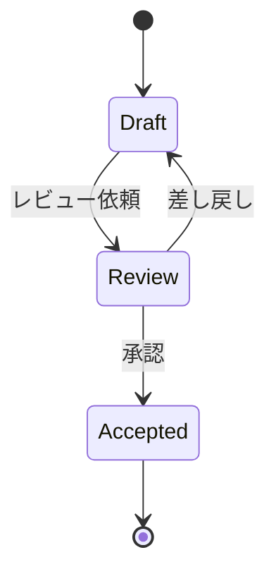

# 10 仕様を書く・読む — Markdown と Mermaid

> 所要 30 分。人間の本業である「仕様と評価基準を書く」を速くする。

## 読む

| キー | 動作 |
|------|------|
| `<Space>mo` | 見出しの一覧（目次）から跳ぶ |
| `]]` / `[[` | 次 / 前の見出しへ |
| `<Space>tr` | 整形表示と生の Markdown を切り替え |
| `<Space>tz` | Zen モード（読むことに集中） |
| `<Space>mp` / `<Space>mP` | ブラウザでプレビュー / 止める（HTML 設計書・Mermaid も） |
| `gd`（リンクの上） | リンク先のファイル・見出しへ跳ぶ |
| `j` / `k` | 折り返した「見た目の行」単位で動く（Markdown だけ） |

- [ ] このファイルで `<Space>mo` を開き、「書く」に跳んだ
- [ ] `]]` と `[[` で見出しを行き来した
- [ ] `<Space>tr` で生の Markdown を見て、もう一度押して戻した
- [ ] `<Space>mp` でブラウザのプレビューを開き、何か書き足すと追従するのを見た。`<Space>mP` で止めた

## 書く: スニペット

Insert モードで次の言葉を打つと補完の候補に出ます。選んで `<Enter>`、`Tab` で次の入力欄へ。

| 入力 | 展開されるもの |
|------|----------------|
| `spec` | 機能仕様（目的・振る舞い・受け入れ条件・完了の証拠/戻し方） |
| `adr` | ADR（背景・選択肢・決定・影響） |
| `plan` | 計画表（作業・依存・担当・完了の証拠・戻し方） |
| `tasks` | 引き継ぎ（Done / In progress / Next） |
| `mflow` / `mseq` / `mstate` / `mer` | Mermaid のフロー / シーケンス / 状態遷移 / ER 図 |
| `callout` | `> [!NOTE]` などの注記 |
| `today` | 今日の日付 |

下の空行で練習してください（`o` で行を作って Insert モードへ）。

- [ ] `mflow` を展開し、ノードを 3 つにした

- [ ] `callout` を展開して `WARNING` を選んだ

- [ ] `plan` を展開して 1 行埋めた

## 書く: チェックボックスと表

| キー | 動作 |
|------|------|
| `<Space>mx` | チェックボックスを付ける・外す（無ければ作る） |
| `vip` → `ga|` | 表の列を揃える |

```text
| 作業 | 担当 | 完了の証拠 |
|---|---|---|
| API を作る | Maker | make verify が green |
| レビュー | Checker | 差分を見た |
```

- [ ] 上の表の中で `vip` → `ga|` を押して列を揃えた（コードブロックの外にコピーしてから試すとわかりやすい）

## Mermaid をその場で描く

Ghostty では、Mermaid のコードブロックが画像としてバッファの中に描かれます。



- [ ] 上の図が Ghostty の画面に描かれているのを確認した（Terminal.app なら `<Space>mp` で）
- [ ] `Review --> Draft` の行を消して保存し、図が変わるのを見た

## 新しい仕様書を作る

`:e docs/features/新機能.md` のように、**まだ無いディレクトリでも**そのまま開いて保存できます（ディレクトリは自動で作られます）。

## 卒業チェック

- [ ] 仕様書を `spec` スニペットから書き始めるようになった
- [ ] 図を言葉で説明する代わりに Mermaid で描くようになった
